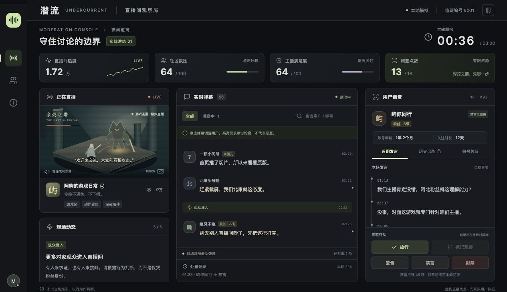

# 潜流 · 直播间观察局

一个完整可玩的中文直播房管游戏原型。React + TypeScript + Vite，完全在本地浏览器运行，无后端、账号、数据库或外部服务。所有人物、主播、直播画面和事件均为虚构。



## 启动

当前项目已安装依赖。在此目录运行（也支持这台电脑的 Codex 内置 Node）：

```sh
./start.sh
```

打开终端显示的本地地址，默认是 http://127.0.0.1:5173。端口被占用时 Vite 会选择下一个端口。

常规 Node.js 环境（建议 Node 22.12+）：

```sh
npm install
npm run dev
```

构建和验证：

```sh
npm run build
npm test
npm run preview
```

## 玩法

- 点击「开始值班」，每轮 180 秒，共 14 位观众、9 种隐藏身份。
- 弹幕自动出现，失误、提及同行、切片传播和观众涌入会改变发言。
- 点击弹幕调查用户。左侧观众图标可打开全部观众名册，方便找回已禁言的用户。
- 近期发言免费；历史记录花费 2 点，账号关系花费 3 点。共 18 点，不会恢复，已解锁的资料可重复查看。
- 放行：解除该用户的当前处置。标记观察：便于在观察列表追踪。警告：短时间减轻争执。禁言：45 秒内阻止未来发言。封禁：阻止本轮后续发言，除非主动解除。
- 社区指标每 10 秒汇总变化，不即时告诉你某次处置是否正确。
- 右上角可以暂停；手册也会暂停现场。暂停期间不能调查或处置。
- 三分钟结束后显示全部角色、关键线索、遗漏和误伤，并支持重新开始。

## 计分说明

恶意账号至少被禁言或封禁一次计为识别；警告和观察不足以计为识别。无辜观众被警告、禁言或封禁均记录为误伤，放行不能抹去此前处置。

准确率 =（正确识别的恶意账号 + 未受处罚的无辜观众）÷ 14。

最终分（满分 1000）= 准确率百分值 × 5 + 社区氛围 × 2.5 + 主播满意度 × 2.5。

越早、越精准地控制冲突，社区损失越少。所有人全部封禁会严重损伤氛围。未处置不等于错误：让无辜观众继续讨论也是职责。

## 原型边界

采用固定剧情与发言顺序，便于比较不同策略。刷新页面会重新开始，不保存历史进度。身份只在结算 UI 中揭示；这是纯前端本地原型，源码可查看，不设计防作弊。

## 文件

- `src/data.ts`：NPC 档案、五个事件、70 条定时弹幕。
- `src/game.ts`：可独立测试的计时、调查、处置与评分逻辑。
- `src/App.tsx`：工作台、调查面板、操作和复盘页面。
- `src/styles.css`：响应式暗色界面，全部视觉资源本地绘制。
- `scripts/game.test.mjs`：完整回合、暂停、点数、禁言、封禁、计分和重开测试。
